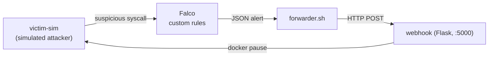

# 🐳 DockerScape — Container Escape Detection Lab

A Docker-based lab that simulates a controlled container escape and uses **[Falco](https://falco.org)** for runtime detection. When Falco sees a suspicious syscall (for example, reading `/host/etc/passwd` from inside a container), a webhook automatically **pauses the offending container**.

> ⚠️ **Lab use only.** This stack runs a privileged Falco container and mounts the Docker socket. Run it on a disposable VM, never on a production or shared host.

## How it works



| Component | Path | Role |
|---|---|---|
| Victim container | `victim/` | Simulates an escape attempt against a read-only host mount |
| Falco + rules | `falco/rules/` | Custom rules: host-mount access, shell spawned in container, `SYS_ADMIN` capability, host `/proc` bind mount |
| Forwarder | `falco/forwarder.sh` | Ships Falco's JSON alerts to the webhook |
| Webhook | `webhook/` | Receives alerts and pauses the offending container via the Docker API |

## Quick start

Requires Docker with Compose, on a Linux host (Falco needs kernel access).

```bash
git clone https://github.com/mani17S/DockerScape.git
cd DockerScape
chmod +x falco/forwarder.sh setup.sh
mkdir -p host_share/etc && echo 'root:x:0:0:root:/root:/bin/bash' > host_share/etc/passwd   # harmless sample file the victim reads
docker compose up -d

# Watch detections live
docker logs -f falco

# Confirm the victim was paused
docker ps -a --filter name=victim-sim
```

Tear down with `docker compose down`.

> **Do not run `setup.sh` on this checkout.** It regenerates the lab's files from embedded copies and would overwrite later changes to the webhook and rules. Start the lab with `docker compose` as above.

## Detection rules

Rules live in `falco/rules/`. Four rules in `local_rules.yaml` plus one in `escape_rules.yaml`: host-mount access (the simulated escape), interactive shell spawned in a container, containers started with `CAP_SYS_ADMIN`, and containers bind-mounting host `/proc`. Edit `local_rules.yaml` to tune or extend them.

## Limitations & next steps

- Response is "pause container" only; no forensics capture before pausing.
- Webhook has no authentication — acceptable on a lab network, not beyond it.
- Planned: an automated test that asserts every rule fires (ATT&CK mapping is in [`docs/DESIGN.md`](docs/DESIGN.md)).

## Docs

- [`docs/DESIGN.md`](docs/DESIGN.md): architecture, what each rule means (with closest ATT&CK technique), threat model, limitations and next steps.
- Related: [detection-engineering-lab](https://github.com/mani17S/detection-engineering-lab) has portable, unit-tested Sigma rules for the same container-escape behaviours.
