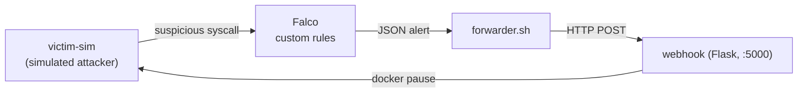

# 🐳 DockerScape — Container Escape Detection Lab

A Docker-based lab that simulates a controlled container escape and uses **[Falco](https://falco.org)** for runtime detection. When Falco sees a suspicious syscall (for example, reading `/host/etc/passwd` from inside a container), a webhook automatically **pauses the offending container**.

> ⚠️ **Lab use only.** This stack runs a privileged Falco container and mounts the Docker socket. Run it on a disposable VM, never on a production or shared host.

## How it works



| Component | Path | Role |
|---|---|---|
| Victim container | `victim/` | Simulates an escape attempt against a read-only host mount |
| Falco + rules | `falco/rules/` | Custom rules, incl. `SYS_ADMIN` capability use and `/proc` mounts |
| Forwarder | `falco/forwarder.sh` | Ships Falco's JSON alerts to the webhook |
| Webhook | `webhook/` | Receives alerts and pauses the offending container via the Docker API |

## Quick start

Requires Docker with Compose, on a Linux host (Falco needs kernel access).

```bash
git clone https://github.com/mani17S/DockerScape.git
cd DockerScape
chmod +x falco/forwarder.sh setup.sh
docker compose up -d

# Watch detections live
docker logs -f falco

# Confirm the victim was paused
docker ps -a --filter name=victim-sim
```

Tear down with `docker compose down`.

## Detection rules

Rules live in `falco/rules/`. They cover behaviours typical of container breakouts, such as reading host files through a mount, using the `SYS_ADMIN` capability and mounting `/proc`. Edit `local_rules.yaml` to tune or extend them.

## Limitations & next steps

- Response is "pause container" only; no forensics capture before pausing.
- Webhook has no authentication — acceptable on a lab network, not beyond it.
- Planned: map each rule to a MITRE ATT&CK for Containers technique, and add a test that asserts every rule fires.

## Docs

See [`docs/`](docs/) for the day-wise log and report.
