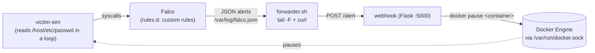

# DockerScape: design notes

How the lab is put together, what each detection means, and where it falls short.

> **Verification note.** These notes describe the configuration as written. Falco needs a Linux kernel host and Docker, so the stack was not re-run while writing this document. Treat the "limitations" section as a list of things to confirm when you run the lab, not as measured results.

## Goal

Demonstrate the full loop of runtime container security on a small, safe scale: **simulate** suspicious behaviour, **detect** it with Falco rules, and **respond** automatically by pausing the offending container.

## Architecture

| Component | File(s) | Behaviour |
|---|---|---|
| Victim | `victim/Dockerfile`, `victim/app.sh` | Alpine container that mounts `./host_share` read-only at `/host` and repeatedly tries to read `/host/etc/passwd`, standing in for a breakout reading host files |
| Detection | `falco/rules/*.yaml` | Custom Falco rules (below), loaded via `rules.d` |
| Transport | `falco/forwarder.sh` | Tails Falco's JSON log and POSTs every line to the webhook |
| Response | `webhook/app.py` | Extracts `container.id` / `container.name` from the alert's `output_fields` and calls `pause()` through the Docker SDK; idempotent if already paused |

## Detections

| Rule | Fires when | Closest ATT&CK technique |
|---|---|---|
| Container Host Mount Access / HostMountAccessDetected | A container process touches a path under `/host` | T1611 Escape to Host |
| Shell Spawned in Container | `bash`/`sh`/`zsh`/`ash` runs inside a container | T1609 Container Administration Command |
| Container with SYS_ADMIN capability | A container runs with `CAP_SYS_ADMIN` | T1611 Escape to Host |
| Container bind mount host /proc | A container accesses `/proc` as a directory | T1611 Escape to Host |

For equivalent behaviour expressed as portable, unit-tested Sigma rules (privileged runs, root mounts, `nsenter` to PID 1, reverse shells), see [detection-engineering-lab](https://github.com/mani17S/detection-engineering-lab).

## Threat model and safety

- The lab is deliberately **privileged**: Falco runs privileged, and the webhook mounts the Docker socket. Anything that can reach the webhook or the socket can control the host's containers. **Run only on a disposable VM.**
- The "attack" is a harmless read of a sample file; nothing here escapes a container for real.

## Limitations and things to confirm when running

1. **Any alert pauses the container.** The webhook does not filter by rule name or priority; any Falco alert carrying a container id triggers a pause. Falco's default rules, if loaded, can therefore pause containers unrelated to the exercise. An allow-list of rule names (and of protected containers such as Falco and the webhook itself) is the obvious next step.
2. **Webhook is unauthenticated** and bound to `0.0.0.0`. Acceptable on an isolated lab network only; add a shared secret or bind to the internal network.
3. **Pause is a weak response.** It freezes processes but preserves memory and disk; there is no forensic capture, alert routing or ticketing.
4. **Rule precision.** `Shell Spawned in Container` will fire on any legitimate interactive debugging session; the `/proc` and `SYS_ADMIN` rules were written as simple tests and have not been tuned against real workloads.
5. **Name resolution.** `forwarder.sh` posts to `http://webhook:5000`. With `network_mode: bridge`, Docker's default bridge does not provide service-name DNS; if alerts do not arrive, check this first (a user-defined network fixes it).
6. **`setup.sh` is a generator, not an installer.** It rewrites `webhook/`, `falco/`, `docker-compose.yml` and `docs/` from embedded copies, so running it on this repo **overwrites later improvements**. Use `docker compose up` directly.

## Next steps

- Rule-name and container allow-lists in the webhook; shared-secret auth.
- Capture `docker inspect` and process lists before pausing.
- Tag each rule with ATT&CK metadata and add an automated test per rule (for example, replaying Falco JSON fixtures through the webhook).
- Move to a user-defined Docker network and drop `privileged` where Falco's modern eBPF driver allows it.
